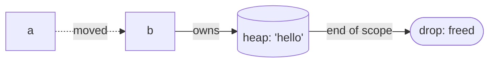

# A Tour of Rust

<div class="cover-meta">Vincent Hiribarren · December 2026</div>

<style>
.cover-rust {
  background: linear-gradient(135deg, #1b1512 0%, #3d1a10 55%, #8a2c17 100%) !important;
}
.cover-rust h1 {
  color: #fff;
}
.cover-rust .cover-meta {
  color: #fff;
  opacity: 0.75;
  margin-top: 1rem;
  font-size: 1.1rem;
}
</style>

---
layout: center
---

# Agenda

<div class="agenda">

1. Rust at a glance
2. What makes Rust different
3. Low-level power, high-level benefits
4. What you should know before starting
5. Wrapping up

</div>

<style>
.agenda ol {
  font-size: 1.4em;
  line-height: 1.9;
}
.agenda li::marker {
  color: var(--slidev-theme-primary);
  font-weight: bold;
}
</style>

---
layout: section
section: Rust at a glance
---

# Rust at a glance

---

# Why Rust, why now?

<div class="grid grid-cols-[1fr_2fr] gap-8 mt-4 items-center">
<div>

<div class="text-6xl font-bold">~70%</div>

of serious security bugs in large C/C++ codebases are memory-safety issues

<div class="text-sm opacity-60 mt-2">Microsoft, Chromium</div>

</div>
<div>

- **C/C++\-level performance**, memory safety checked at compile time, no garbage collector
- **Linux kernel**: Rust accepted since 6.1
- **Android**: memory-safety bugs fell from 76% to 24% of vulnerabilities (2019 → 2024)
- **Governments** (US CISA, NSA) now recommend memory-safe languages

</div>
</div>

<div class="mt-8 mb-3 font-bold">One language, from bare metal to the browser</div>

<div class="grid grid-cols-6 gap-3 text-center domains">
  <div><mdi-chip class="text-4xl text-primary" /><div class="font-bold">Embedded</div><div class="ex">microcontrollers, no OS</div></div>
  <div><mdi-memory class="text-4xl text-primary" /><div class="font-bold">Low-level</div><div class="ex">kernels, drivers, firmware</div></div>
  <div><mdi-cogs class="text-4xl text-primary" /><div class="font-bold">Systems</div><div class="ex">runtimes, databases, networking</div></div>
  <div><mdi-monitor-dashboard class="text-4xl text-primary" /><div class="font-bold">Desktop apps</div><div class="ex">Tauri, Zed</div></div>
  <div><mdi-server class="text-4xl text-primary" /><div class="font-bold">Web backend</div><div class="ex">Axum, Cloudflare, Discord</div></div>
  <div><mdi-web class="text-4xl text-primary" /><div class="font-bold">Web frontend</div><div class="ex">WebAssembly, Leptos</div></div>
</div>

<style>
.domains .ex {
  font-size: 0.75em;
  opacity: 0.6;
  line-height: 1.3;
}
</style>

---

# What's in the box?

<div class="grid grid-cols-2 gap-x-10 checklist">
<div>

**Comes with the toolchain**

- <mdi-check-circle class="ok" /> Install and update: `rustup`
- <mdi-check-circle class="ok" /> Projects and dependencies: `cargo new`, `cargo add`
- <mdi-check-circle class="ok" /> Package registry: [crates.io](https://crates.io)
- <mdi-check-circle class="ok" /> Tests: `cargo test`
- <mdi-check-circle class="ok" /> Formatter and linter: `cargo fmt`, `cargo clippy`
- <mdi-check-circle class="ok" /> Documentation: `cargo doc`, [docs.rs](https://docs.rs)

</div>
<div>

**Missing or partial**

- <mdi-close-circle class="ko" /> "Batteries included" standard library
- <mdi-close-circle class="ko" /> Async runtime: pick one, usually Tokio
- <mdi-alert-circle class="partial" /> GUI: no official toolkit
- <mdi-alert-circle class="partial" /> Compile times: slow on large projects

</div>
</div>

<style>
.checklist ul { list-style: none; padding-left: 0; }
.checklist li { margin: 0.5em 0; padding-left: 1.6em; text-indent: -1.6em; line-height: 1.4; }
.checklist li svg { vertical-align: -0.2em; margin-right: 0.35em; }
.checklist .ok { color: #2a9d8f; }
.checklist .ko { color: var(--slidev-theme-primary); }
.checklist .partial { color: #e9a23b; }
</style>

---

# Syntax at a glance

<p class="glance-sub">Almost everything is an expression: it has a value</p>

<div class="glance">

```rust {all|1|3-5|8-10|12|13-14|16-18}
struct User { name: String, age: u32 }

fn is_adult(age: u32) -> bool {
    age >= 18                // no `;`: this value is returned, no `return`
}

fn main() {
    let mut users = Vec::new(); // immutable by default, `mut` to change it
    users.push(User { name: String::from("Ada"), age: 36 });
    users.push(User { name: String::from("Tim"), age: 12 });

    let adults = users.iter().filter(|u| is_adult(u.age)).count(); // `|u| …` is a closure
    let label = if adults == 1 { "adult" } else { "adults" };      // `if` has a value
    println!("{adults} {label}");                                  // 1 adult

    for User { name, age } in users {   // loops: `for`, `while`, `loop`
        println!("{name} is {age}");
    }
}
```

</div>

<style>
.glance-sub {
  margin: -0.5rem 0 0.5rem;
}
.glance {
  --slidev-code-font-size: 13px;
  --slidev-code-line-height: 16px;
  --slidev-code-margin: 0;
}
</style>

---

# Methods, traits and enums

<p class="glance-sub">No classes, no inheritance</p>

<div class="grid grid-cols-2 gap-6 glance">
<div>

**Methods** live in `impl`, **traits** share behaviour

```rust
struct User { name: String, age: u32 }

impl User {                    // ada.is_adult()
    fn is_adult(&self) -> bool {
        self.age >= 18
    }
}

trait Describe {
    fn describe(&self) -> String;
}

impl Describe for User {
    fn describe(&self) -> String {
        format!("{}, {}", self.name, self.age)
    }
}
```

</div>
<div>

**Enums** can carry data, and `match` must cover every case

```rust
enum Event {
    Quit,                     // no data
    KeyPress(char),           // one value
    Resize(u32, u32),         // several values
    Click { x: i32, y: i32 }, // named fields
}

match event {
    Event::Quit => stop(),
    Event::KeyPress(c) => insert(c),
    Event::Resize(w, h) => layout(w, h),
    Event::Click { x, y } => select(x, y),
}
```

</div>
</div>

<style>
.glance-sub {
  margin: -0.5rem 0 0.5rem;
}
.glance p {
  margin: 0 0 0.4rem;
}
.glance {
  --slidev-code-font-size: 13px;
  --slidev-code-line-height: 18px;
  --slidev-code-margin: 0;
}
</style>

---
layout: section
section: What makes Rust different
---

# What makes Rust different

---

# What makes Rust different

Memory safety without a garbage collector — and whole classes of logic bugs gone

<div class="grid grid-cols-3 gap-6 mt-6">
<div>

### C / C++
Control and performance

❌ Use-after-free, buffer overflows, data races

❌ `NULL`, ignored error codes

</div>
<div>

### Java / Go / Python
Memory safe

❌ Garbage collector and runtime

❌ Null pointer exceptions, forgotten exceptions, concurrent modification

</div>
<div>

### Rust 
Control, performance **and** memory safety

✅ Checked by the compiler: memory, but also null, forgotten cases, ignored errors, hidden mutation

</div>
</div>

<div class="mt-6 text-center italic">

Modern C++ best practices, made mandatory and checked by the compiler — so even a newcomer to low-level programming is protected

</div>

<div class="mt-6">

**How?** Ownership · One writer *or* many readers ·
Always initialized, no null

</div>

---

# Ownership


Every value has exactly one owner, and is freed when its owner goes out of scope — no GC

```rust
fn main() {
    let a = String::from("hello");
    let b = a;              // ownership moves from `a` to `b`

    // println!("{a}");     // ❌ error: borrow of moved value: `a`
    println!("{b}");
}                           // `b` goes out of scope: memory is freed (drop)
```




---

# One writer *or* many readers

At any time, either one mutable reference `&mut T`, or any number of shared references `&T`

<div class="readers">

<div class="grid grid-cols-2 gap-4">
<div>

**Python**: no error, wrong result

```python
nums = [2, 4, 6, 7]
for i, n in enumerate(nums):
    if n % 2 == 0:
        del nums[i]  # shifts the list
                     # under the loop
print(nums)          # [4, 7] 😱
```

</div>
<div>

**Rust**: the loop reads, the body writes

```rust
let mut nums = vec![2, 4, 6, 7];
for (i, n) in nums.iter().enumerate() {
    if n % 2 == 0 {
        nums.remove(i); // ❌ E0502
    }
}
```

</div>
</div>

<div v-click class="grid grid-cols-3 gap-4 my-3 text-center">
  <div class="border-2 border-green-600 rounded-lg p-2">✅ <code>&v</code> <code>&v</code> <code>&v</code><div class="text-sm">many readers</div></div>
  <div class="border-2 border-green-600 rounded-lg p-2">✅ <code>&mut v</code><div class="text-sm">one writer</div></div>
  <div class="border-2 border-red-600 rounded-lg p-2">❌ <code>&v</code> + <code>&mut v</code><div class="text-sm">never both at once</div></div>
</div>

<div v-click>

```rust
let mut v = vec![1, 2, 3];
let first = &v[0];          // reader: shared borrow
v.push(4);                  // ❌ writer: may reallocate the buffer...
println!("{first}");        // ...while `first` still points into it
// error[E0502]: cannot borrow `v` as mutable because it is also borrowed as immutable
```

</div>

</div>

<style>
.readers {
  --slidev-code-font-size: 12px;
  --slidev-code-line-height: 16px;
  --slidev-code-margin: 0;
}
.readers p {
  margin: 0 0 0.3rem;
}
</style>


---

# Always initialized, no null


A value exists only once it is fully initialized — absence is a type, not a null pointer

```rust
let x: i32;
println!("{x}");            // ❌ error: used binding `x` isn't initialized

struct User { name: String, age: u32 }
let u = User { name: "Ada".into() }; // ❌ error: missing field `age`

let users: Vec<User> = load_users();
match users.first() {       // returns Option<&User>
    Some(user) => println!("Hello {}", user.name),
    None => println!("No users"),
}
```


---
layout: section
section: Low-level power, high-level benefits
---

# Low-level power, high-level benefits

A language as fast as C, usable for everything… and on top of that:

- **Whole classes of bugs eliminated**
  - Resources always released
  - Limit who can write
- **Patterns that shine in high-level code**
  - Typestate: invalid states don't compile
  - `Option` and `Result`: check before you use

---

# Resources are always released

Files, locks, sockets…: released at the end of the scope, on every path

<div class="grid grid-cols-2 gap-4 vs">
<div>

**Python**

```python
def update(cache):
    lock.acquire()
    if not cache:
        return False  # 💥 lock never released:
                      #    deadlock on next call
    cache.append(42)
    lock.release()
    return True
```

</div>
<div>

**Rust**

```rust
fn update(cache: &Mutex<Vec<u32>>) -> bool {
    let mut items = cache.lock().unwrap();
    if items.is_empty() {
        return false; // unlocked here...
    }
    items.push(42);
    true
}                     // ...and here
```

</div>
</div>

Python has `with` — but you have to remember to use it. In Rust, the `Mutex` **owns** the data: no lock, no access.

<style>
.vs {
  --slidev-code-font-size: 12px;
  --slidev-code-line-height: 17px;
}
</style>

---

# Limit who can write


The signature says whether a function may modify what you pass it

<div class="grid grid-cols-2 gap-4 vs">
<div>

**Python**

```python
def total(prices):
    prices.sort()  # surprise: mutates the caller's list
    return sum(prices)

cart = [30, 10, 20]
total(cart)
print(cart)        # [10, 20, 30]
```

</div>
<div>

**Rust**

```rust
fn total(prices: &[u32]) -> u32 {
    // prices.sort(); // ❌ cannot borrow `*prices` as mutable
    prices.iter().sum()
}
fn apply_discount(prices: &mut [u32]) { /* ... */ }

let mut cart = vec![30, 10, 20];
total(&cart);              // read-only, guaranteed
apply_discount(&mut cart); // mutation visible at the call site
```

</div>
</div>

<style>
.vs {
  --slidev-code-font-size: 11px;
  --slidev-code-line-height: 16px;
}
</style>


---

# The typestate pattern

Closing takes ownership: the object is gone, the compiler won't let you touch it again

<div class="grid grid-cols-2 gap-4 vs">
<div>

**Python**

```python
conn = connect()
conn.close()
conn.send("hi")  # 💥 runtime error,
                 #    or silently ignored:
                 #    depends on the library
conn.close()     # nothing stops a second close
```

</div>
<div>

**Rust**

```rust
impl Connection {
    fn close(self) { /* ... */ } // takes `self`
}

let conn = connect();
conn.close();    // `conn` is moved...
conn.send("hi"); // ❌ borrow of moved value
```

</div>
</div>

<div class="vs mt-4">

With more states, each state is its own type, with only the methods that make sense:

```rust
let door = ClosedDoor::new();  // a ClosedDoor
let door = door.lock();        // now a LockedDoor
door.open();                   // ❌ a LockedDoor has no `open` method
```

Bonus: autocompletion only suggests what is valid in the current state (here: `unlock()`)

</div>

<style>
.vs {
  --slidev-code-font-size: 12px;
  --slidev-code-line-height: 17px;
}
.vs p {
  margin: 0 0 0.3rem;
}
</style>


---

# <code>Option</code> and <code>Result</code>: check before you use

No null, no exceptions: absence and failure must be checked before use

<div class="grid grid-cols-2 gap-4 vs">
<div>

**Python**

```python
user = find_user(42)   # may return None
print(user.name)
# 💥 AttributeError: 'NoneType' object
#    has no attribute 'name'

port = int(text)       # may raise ValueError
# nothing in the signature warned you
```

</div>
<div>

**Rust**

```rust
let user = find_user(42);      // Option<User>
// user.name                   // ❌ no field `name`
if let Some(user) = user {
    println!("{}", user.name);
}

let port: u16 = text.parse()?; // handled or propagated
// let port: u16 = text.parse(); ❌ mismatched types
```

</div>
</div>


<style>
.vs {
  --slidev-code-font-size: 11px;
  --slidev-code-line-height: 16px;
}
</style>

---
layout: section
section: What you should know before starting
---

# What you should know before starting

- It's still low-level
- A steep learning curve
- A small standard library
- Structs and field access
- When the types take over

---
clicks: 5
---

# It's still low-level

<p class="lowlevel-sub">Safe doesn't mean simple: memory is still your business</p>

<div class="grid grid-cols-2 gap-x-6 gap-y-3 lowlevel">
<div :class="{ dim: $clicks > 0 && $clicks !== 1 }">

**Stack or heap**, and numbers with a size

```rust
let a = [0u8; 64];     // stack: fixed size
let v = vec![0u8; 64]; // heap: can grow
let n: u8 = 255;       // sized: u8, i32, u64…
let m = n as u32 + 1;  // explicit conversion
```

</div>
<div :class="{ dim: $clicks > 0 && $clicks !== 2 }">

**<code>String</code> vs <code>&str</code>**: two string types

```rust
let mut s = String::new(); // owned...
s.push_str("Ada");         // ...so it can grow
let view: &str = &s;       // borrowed: read-only
let lit: &str = "Tim";     // literals are &str
```

</div>
<div :class="{ dim: $clicks > 0 && $clicks !== 3 }">

**Size matters**: known at compile time

```rust
fn label(n: i32) -> impl Display {
    if n > 0 { n } else { "none" } // ❌ 2 types
} // fix: -> Box<dyn Display>

struct Node { next: Option<Node> }      // ❌ infinite
struct Node { next: Option<Box<Node>> } // ✅ Box
```

</div>
<div :class="{ dim: $clicks > 0 && $clicks !== 4 }">

**Scopes**: a reference can't outlive its value

```rust
let r;
{
    let x = 5;
    r = &x;
}                // ❌ `x` dies here...
println!("{r}"); // ...but `r` is still used
```

</div>
<div class="col-span-2" :class="{ dim: $clicks > 0 && $clicks !== 5 }">

**Smart pointers**: when one owner isn't enough

```rust
let shared = Rc::new(config);         // several owners, one thread
let synced = Arc::new(Mutex::new(0)); // several owners, across threads, with a lock
let cell = RefCell::new(vec![]);      // mutable through a shared reference, checked at runtime
```

</div>
</div>

<style>
.lowlevel-sub {
  margin: -0.5rem 0 0.75rem;
}
.lowlevel > div {
  transition: opacity 0.3s;
}
.lowlevel .dim {
  opacity: 0.2;
}
.lowlevel {
  --slidev-code-font-size: 11.5px;
  --slidev-code-line-height: 16px;
  --slidev-code-margin: 0;
}
.lowlevel p {
  margin: 0 0 0.3rem;
  font-size: 0.85em;
}
</style>

---

# A steep learning curve

<div class="grid grid-cols-[1fr_auto] gap-8 items-center mt-6">
<div>

- You get stuck on **how** to write it, not only on bugs
- AI assistants help — but Rust is learned by **writing** it: the reflexes only come with practice
- Beware of **frameworks that hide the complexity** (Bevy for games, Axum or Leptos for the web): easy at first, a wall as soon as you step outside them
- A **new constraint** (say, "this must now run on several threads") can mean **rewriting** a lot of code: ownership choices show up in every type and signature

</div>

</div>

---

# A small standard library

<div class="grid grid-cols-2 gap-6 text-sm stdlib">
<div>

**✅ In `std`**

- Collections: `Vec`, `HashMap`, `HashSet`, `BTreeMap`, `VecDeque`
- Strings, formatting, iterators, `Option` and `Result`
- Files, paths, I/O, processes, environment variables
- Threads, `Mutex`, `Arc`, channels, atomics
- TCP and UDP sockets, `Duration` and `Instant`

</div>
<div>

**❌ Not in `std`**

- Random numbers, regex
- JSON and serialization
- HTTP client or server
- Async runtime
- Dates and time zones

</div>
</div>

<style>
.stdlib p { margin: 0 0 0.2rem; }
.stdlib li { margin: 0; line-height: 1.5; }
</style>

```bash
$ cargo new my-service && cd my-service
$ cargo add rand regex chrono serde serde_json tokio reqwest anyhow
$ cargo tree | wc -l        # a typical web service: often hundreds of crates
```

- The ecosystem fills the gaps — and the community has de facto standards (`serde`, `tokio`…)
- But you have to choose, audit and update your dependencies
- More crates also means longer build times

---

# Structs and field access


Ownership rules look simple — until you borrow through `self`

```rust
struct Game {
    players: Vec<Player>,
    score: u32,
}

impl Game {
    fn add_points(&mut self, n: u32) { self.score += n; }

    fn play(&mut self) {
        for p in &self.players {        // borrows `self.players`...
            self.score += p.points;     // ✅ another field: fine
            self.add_points(p.points);  // ❌ ...but a method borrows *all* of `self`
        }
    }
}
```


---

# When the types take over


Every piece makes sense on its own… together, good luck

<div class="horror">

```rust
fn subscribe<'a, 'b: 'a, K, F>(
    registry: &'a Arc<Mutex<HashMap<K, Vec<Rc<RefCell<Box<dyn FnMut(&'b str) + 'b>>>>>>>,
    key: K,
    callback: F,
) -> Pin<Box<dyn Future<Output = Result<usize, Box<dyn Error + Send + Sync>>> + 'a>>
where
    K: Eq + Hash + 'b,
    F: for<'c> FnMut(&'c str) + 'b,
{
    Box::pin(async move {
        let callback: Box<dyn FnMut(&'b str) + 'b> = Box::new(callback);
        let mut map = registry.lock().map_err(|e| e.to_string())?;
        let subscribers = map.entry(key).or_default();
        subscribers.push(Rc::new(RefCell::new(callback)));
        Ok::<_, Box<dyn Error + Send + Sync>>(subscribers.len())
    })
}
```

</div>

<style>
.horror {
  --slidev-code-font-size: 11px;
  --slidev-code-line-height: 16px;
}
</style>


---
layout: section
section: Wrapping up
---

# Wrapping up

---
layout: center
---

# Key takeaways

- **Universal**: from microcontrollers to the browser, with one tool
- **Memory safe without a garbage collector**
- **Whole classes of bugs** caught at compile time
- **Patterns** that shine in high-level code too
- **A real learning curve** — worth it

---

# Resources

<div class="grid grid-cols-2 gap-x-8 text-sm reading">
<div>

**Getting started**
- Install: [rustup.rs](https://rustup.rs)
- *The Rust Programming Language*, "the book": [doc.rust-lang.org/book](https://doc.rust-lang.org/book/)
- Small exercises: [Rustlings](https://github.com/rust-lang/rustlings)
- Learn by reading code: [Rust by Example](https://doc.rust-lang.org/rust-by-example/)
- Try it in the browser: [play.rust-lang.org](https://play.rust-lang.org)

**Reference and ecosystem**
- [Rust Language Cheat Sheet](https://cheats.rs/)
- [An unofficial guide to the Rust ecosystem](https://blessed.rs/)

</div>
<div>

**Going further**
- [Common Rust lifetime misconceptions](https://github.com/pretzelhammer/rust-blog/blob/master/posts/common-rust-lifetime-misconceptions.md)
- [Tour of Rust’s standard library traits](https://github.com/pretzelhammer/rust-blog/blob/master/posts/tour-of-rusts-standard-library-traits.md)
- [Sizedness in Rust](https://github.com/pretzelhammer/rust-blog/blob/master/posts/sizedness-in-rust.md)
- [Object soup is made of indexes](https://jacko.io/object_soup.html)
- [*Learn Rust With Entirely Too Many Linked Lists*](https://rust-unofficial.github.io/too-many-lists/)
- [Why Async Rust?](https://without.boats/blog/why-async-rust/)
- [Design of Pin](https://without.boats/blog/pin/)

</div>
</div>

<style>
.reading p { margin: 0.6em 0 0.2em; }
.reading li { margin: 0; line-height: 1.6; }
</style>

---

<div class="grid grid-cols-[1fr_2fr] gap-8 items-center h-full thanks">
<div class="text-center">

# Thank you!

Questions?


</div>
<div>

A complete web API

```rust
// Cargo.toml: actix-web = "4"
use actix_web::{get, web, App, HttpServer};

#[get("/thanks/{name}")]
async fn thanks(name: web::Path<String>) -> String {
    format!("Thank you, {name}! 🦀")
}

#[actix_web::main]
async fn main() -> std::io::Result<()> {
    HttpServer::new(|| App::new().service(thanks))
        .bind(("0.0.0.0", 3000))?
        .run()
        .await
}

// $ curl localhost:3000/thanks/everyone
```

</div>
</div>

<style>
.thanks {
  --slidev-code-font-size: 12px;
  --slidev-code-line-height: 17px;
}
.thanks p {
  margin: 0 0 0.4rem;
}
</style>
